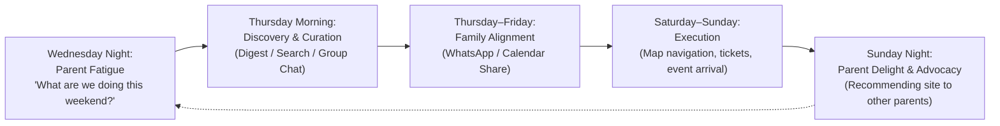
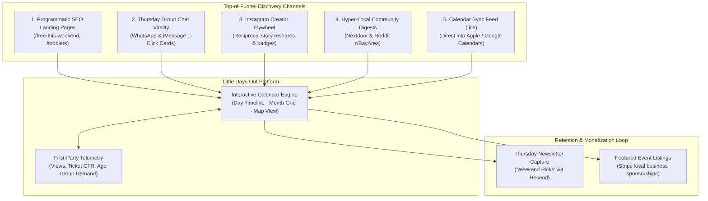
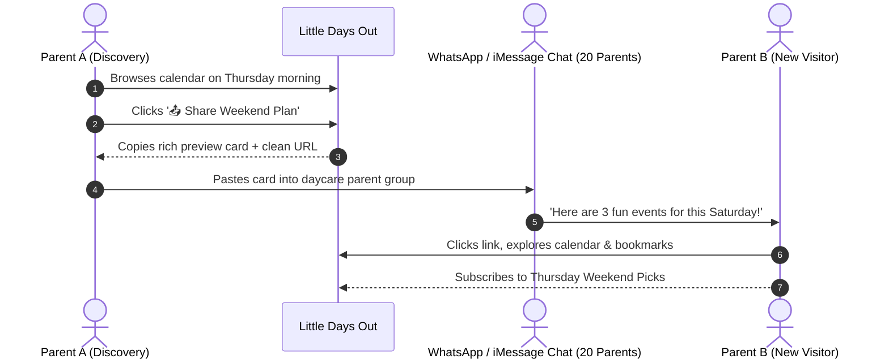

# 1-Pager Growth Strategy: Scaling Parent Traffic for Little Days Out

**Platform:** [Little Days Out](https://www.littledaysout.com) (`littledaysout.com`)  
**Target Audience:** Parents & Caregivers in the San Francisco Bay Area (SF, Peninsula, South Bay, East Bay)  
**Primary Objective:** Scale organic, recurring parent traffic from 0 &rarr; 10,000+ monthly active families through zero-cost viral and organic loops.

---

## 1. Executive Summary & Parent Psychology

Planning weekend activities with children in the Bay Area is exhausting. Parents face fragmented Instagram posts, outdated event aggregator blogs buried in ads, and clunky municipal recreation PDFs. 

Parents follow a predictable decision cycle:
* **The Planning Window:** 75% of family weekend planning happens between **Wednesday 6:00 PM and Thursday 12:00 PM**.
* **High-Trust Channels:** Parents trust peer recommendations in closed **WhatsApp / iMessage daycare groups** and **Nextdoor neighborhood threads** 10x more than generic search ads.
* **The Value Proposition:** A lightning-fast, ad-free interactive calendar categorized by age group (infants &rarr; teens), cost (free vs. paid), and geography.

---

## 2. The 5 Growth Pillars

---

### Pillar 1: Programmatic SEO & Intent Landing Pages (Compounding Inbound)

Parents frequently type high-intent, date-sensitive queries into Google. Because our database already structures events by age group, cost, and geography with Schema.org `Event` and `ItemList` JSON-LD, we can generate dynamic, indexable landing pages with near-zero ongoing effort:

* **High-Volume Search Targets:**
  * `/free-this-weekend` &rarr; *"Free kids activities in the Bay Area this weekend"*
  * `/toddlers` &rarr; *"Things to do with toddlers in SF & Peninsula"*
  * `/indoor-activities` &rarr; *"Rainy day indoor activities for kids Bay Area"*
  * `/locations/san-jose`, `/locations/san-francisco`, `/locations/east-bay`
* **Competitive Moat:** Traditional city guides (e.g. Mommy Poppins, Red Tricycle) are heavy articles written weeks in advance with broken dates. Our programmatic pages are **live, auto-updating feeds** tied to actual upcoming calendar dates.

---

### Pillar 2: The Group Chat Viral Share Loop (Frictionless Word of Mouth)

Parent social networks operate inside closed messaging apps: daycare WhatsApp chats, soccer team threads, and neighborhood group texts. When one parent finds a great activity, they share it with 10–20 other parents.

* **Tactical Implementation:**
  * Add an **"📤 Share Weekend Plan"** button at the top of the calendar.
  * Formats a clean, readable text snippet with OpenGraph thumbnail:
    > *"🎪 Found 3 fun things happening around the Bay this weekend: [1] CuriOdyssey Science Festival, [2] Puppet Show in Palo Alto, [3] Free Toddler Art in San Jose. See details & maps: littledaysout.com/?date=2026-11-08"*

---

### Pillar 3: The Instagram Creator Flywheel (Mutual Audience Amplification)

The pipeline already scrapes and indexes 30+ top Bay Area family influencers and municipal accounts. Instead of treating this as a one-way ingestion, turn it into a partnership flywheel:

1. **Reciprocal Attribution:** On each event card, we feature the source handle (`@bayarea_toddlerexplorer`) with a direct outbound referral link (tracked by our Phase 2 telemetry).
2. **"Featured on Little Days Out" Outreach:**
   * Automated or semi-automated DM/comment when their post is verified:
     > *"Hey! We loved your recommendation of the Los Altos train park and featured it on today's Little Days Out calendar for hundreds of local Bay Area parents! Here's the direct link: littledaysout.com..."*
3. **Incentive for Creators:** Micro-influencers crave credibility and backlinks. When external sites feature them, they share screenshots to their Instagram Stories, instantly funneling thousands of local parent followers to our site.

---

### Pillar 4: Hyper-Local Nextdoor & Reddit Community Roundups

Nextdoor and local subreddits (`r/BayArea`, `r/SanFrancisco`, `r/SanJose`, `r/Oakland`) strictly prohibit self-serving spam, but **consistently upvote genuine, well-curated community utility posts**.

* **The Thursday 8:30 AM Playbook:**
  * Title: *"Hey neighbors! Here's a curated list of free & cheap kids events happening around the Bay this weekend (Nov 8–9)"*
  * Body: 4–5 bullet points categorized by North/South/East Bay with dates, times, and stroller accessibility notes.
  * Footer: *"Full interactive map and calendar updated daily at littledaysout.com — built by a local parent."*
* **Expected Result:** Generates 200–500 high-intent local visitors in a single day, with a 15–20% email newsletter conversion rate.

---

### Pillar 5: Apple & Google Calendar Subscription (.ics Feed)

Bookmarking a website requires remembering to visit it. Syncing to a phone calendar is permanent.

* **Mechanism:** Add a **"📅 Add Weekend Picks to Calendar"** button.
* **Deliverable:** An automated `.ics` webcal feed that inserts 2–3 curated weekend picks directly into the parent's Apple or Google Calendar every Friday morning.
* **Impact:** Places *Little Days Out* directly on the parent's phone home screen and calendar widget without requiring an iOS App Store build.

---

## 3. Prioritized Execution Matrix

| Initiative | Expected Traffic Impact | Engineering Effort | Timeline | First Step |
| :--- | :---: | :---: | :---: | :--- |
| **1. Group Chat Share Button** | **High** (Viral multiplier) | Low (1–2 days) | Week 1 | Add copy-to-clipboard WhatsApp / iMessage share modal on `/` |
| **2. Thursday Nextdoor/Reddit Routine** | **Medium–High** (Immediate traffic spike) | None (Operational) | Week 1 | Post first curated Thursday morning digest |
| **3. Programmatic SEO Pages** | **Very High** (Long-term compounding) | Medium (3–4 days) | Week 2 | Build `/free-this-weekend` and `/toddlers` dynamic routes |
| **4. 1-Click Calendar Sync (.ics)** | **High** (Lifetime retention) | Medium (2–3 days) | Week 3 | Build `/api/calendar/feed.ics` dynamic endpoint |
| **5. Creator Outreach Flywheel** | **Medium** (Brand credibility) | Low (Ongoing) | Week 3 | Send 5 DMs to featured Instagram accounts |

---

## 4. Key Metrics & Telemetry Goals (Phase 2 Alignment)

Using the newly deployed **📈 Traffic & Analytics** engine:

* **Weekly Active Parents (WAP):** Target 1,000 WAP within 60 days.
* **Outbound Ticket Conversion (CTR):** Maintain >15% CTR (proving parent high commercial intent).
* **Viral Coefficient ($K$-factor):** Track `click_share_chat` events & incoming referral query parameters (`?ref=share_chat`).
* **Repeat Visit Frequency:** Measure the percentage of parents returning every Thursday–Saturday.
